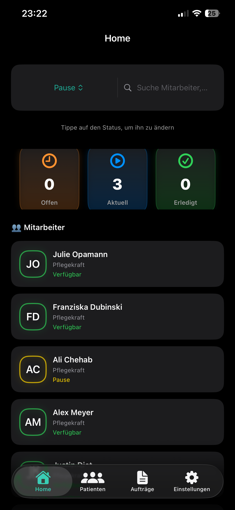
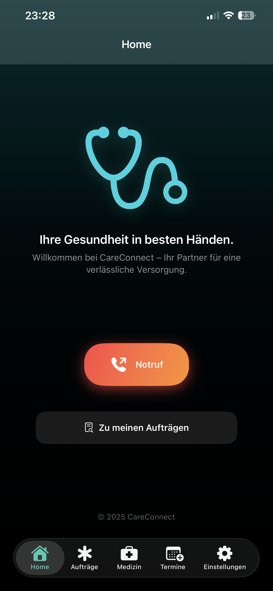
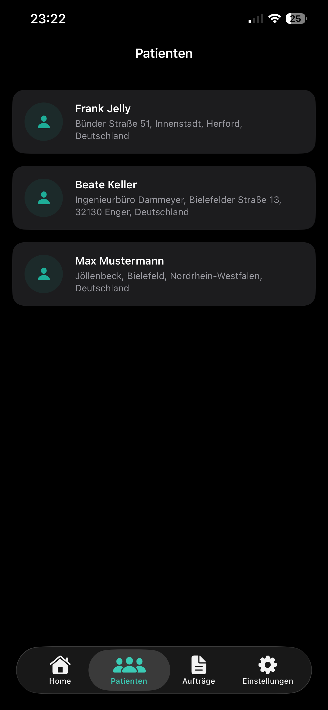
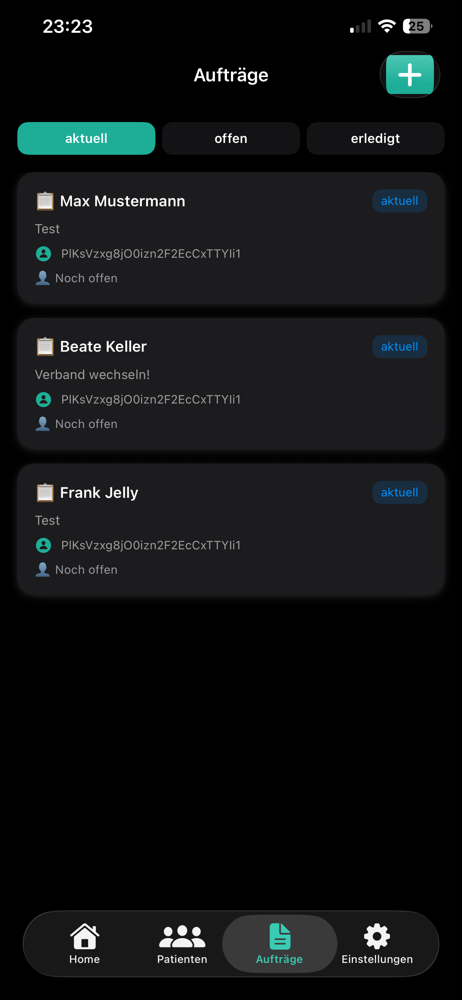
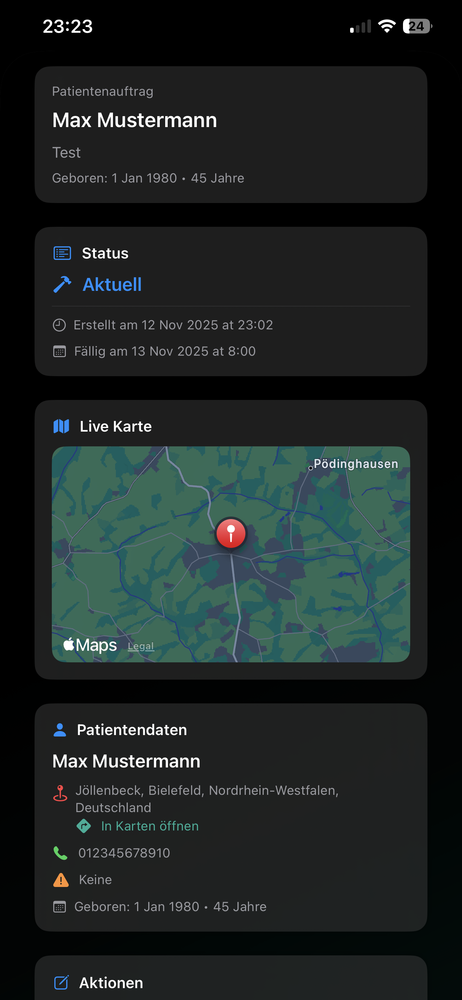
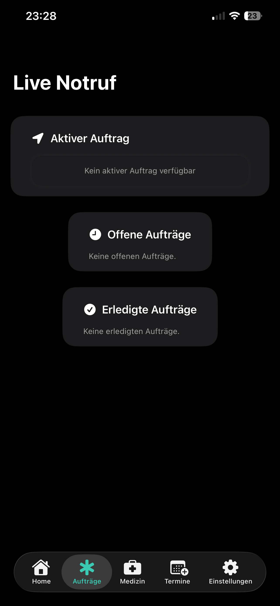
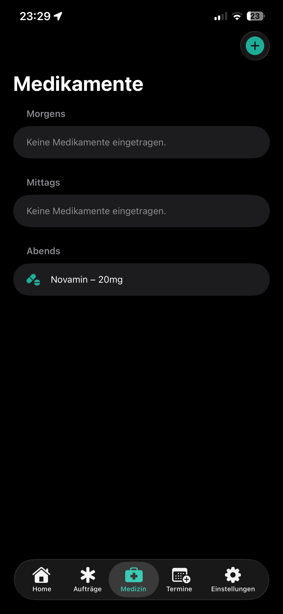
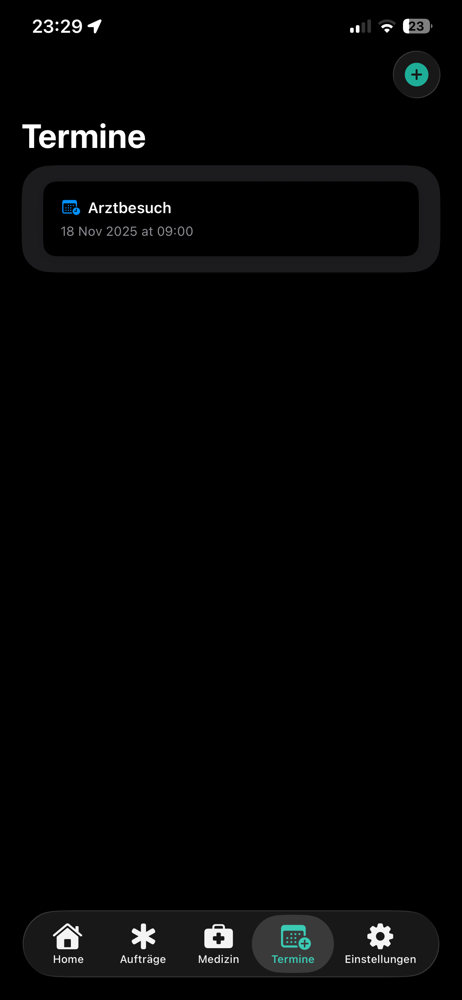
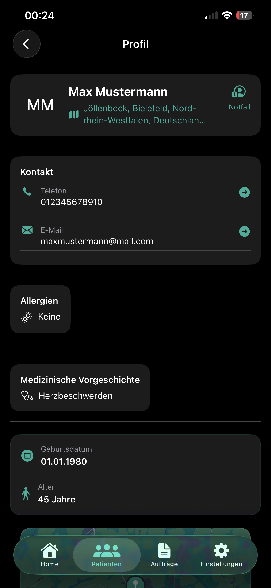
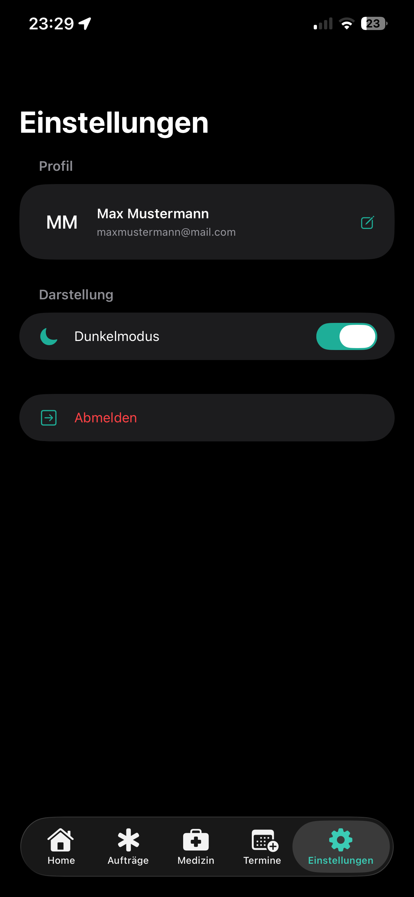

# 📱 CareConnect  
**Die moderne All-in-One Pflege-App für Pflegekräfte & Patienten**

CareConnect ist eine intuitive, moderne und sichere iOS-App, die speziell für Pflegekräfte entwickelt wurde, um den Alltag einfacher, effizienter und übersichtlicher zu gestalten.  
Die App unterstützt bei Patientenverwaltung, Medikamentenplanung, Terminen, Live-Notrufen, Profilverwaltung und vielem mehr.

---

# 🌟 Features

## 🏠 Startseite
- Begrüßung des Nutzers  
- Großer Notruf-Button  
- Schnellzugriff auf aktuelle Aufträge  

**Screenshot:**  

---

## 🧑‍🤝‍🧑 Patientenverwaltung
- Vollständige Liste aller Patienten  
- Adresse, Kontakt, medizinische Infos  
- Standort via Apple Maps  
- Profil bearbeiten  

**Screenshot:**  

---

## 📝 Auftragsmanagement
- Aktuelle, offene und erledigte Aufträge  
- Detailansicht mit Karte  
- Live-Notruf-Bereich  

**Screenshot:**  

---

## 💊 Medikamentenverwaltung
- Medikamente sortiert nach **Morgen / Mittag / Abend**  
- Neues Medikament hinzufügen  
- Übersichtliche Struktur  

**Screenshot:**  

---

## 📅 Termine
- Arzttermine planen  
- Übersichtliche Listenansicht  
- Termine hinzufügen  

**Screenshot:**  

---

## 👤 Patienten-Profil bearbeiten
- Vorname, Nachname, Adresse  
- Telefonnummer, E-Mail  
- Allergien, Krankengeschichte  
- Profilbild ändern  
- Passwort ändern  

**Screenshot:**  

---

## ⚙️ Einstellungen
- Profil anzeigen  
- Dark Mode / Light Mode  
- Abmelden  

**Screenshot:**  

---

# 🛠️ Tech-Stack

| Bereich | Technologie |
|--------|-------------|
| Sprache | Swift |
| UI Framework | SwiftUI |
| Architektur | MVVM |
| Backend | Firebase Firestore |
| Authentifizierung | Firebase Auth |
| Storage | Firebase Storage |
| Karten | Apple Maps |
| iOS Version | iOS 17+ |
| IDE | Xcode 18+ |

---

# 📁 Projektstruktur**

CareConnect/
│
├── Views/                # Alle Screens
├── ViewModels/           # Logik & State Management
├── Models/               # Datenmodelle
├── Services/             # Firebase, Location, Auth
├── Components/           # Wiederverwendbare UI-Bausteine
├── Resources/            # App Icons, Farben, Assets
└── CareConnectApp.swift  # Einstiegspunkt der App

---

# 🚀 Installation

### Voraussetzungen:
- macOS + Xcode 18 oder neuer  
- Firebase-Projekt  
- GoogleService-Info.plist  

### Schritte:
1. Repository klonen  
2. Projekt in Xcode öffnen  
3. GoogleService-Info.plist einfügen  
4. App auf Gerät oder Simulator starten  

---

# 📚 Verwendung

- Patientenprofil anlegen & bearbeiten  
- Medikamente verwalten  
- Termine planen  
- Aufträge einsehen  
- Notruf schnell auslösen  
- Profil und Passwort ändern  

---

# 🧭 Roadmap

- Push-Benachrichtigungen  
- Tourenplanung für Pflegekräfte  
- Kalender mit Erinnerungen  
- Exportfunktionen (PDF/CSV)  
- Rollen- und Rechteverwaltung  
- Unterstützung mehrerer Pflegeeinrichtungen  

---

# 👤 Kontakt

**Entwickler:** Ali Chehab  
🔗 LinkedIn: www.linkedin.com/in/ali-chehab-32a7a7364  

---

**CareConnect – Ihre Gesundheit in besten Händen.**
