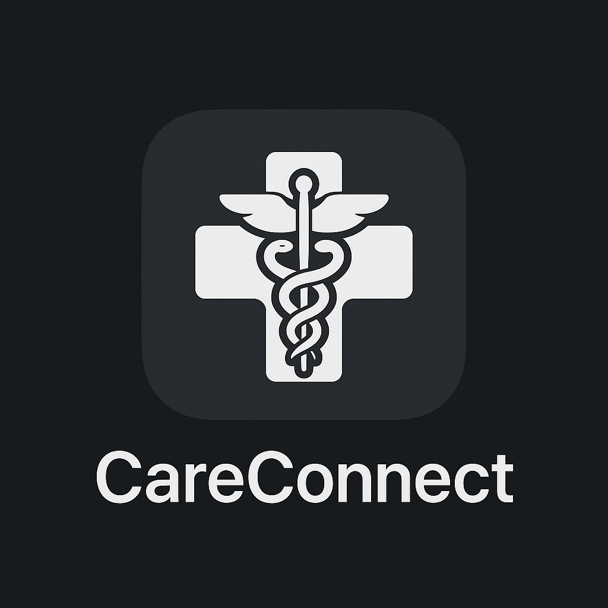
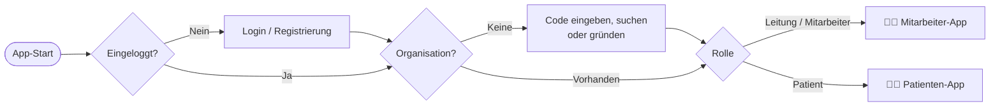
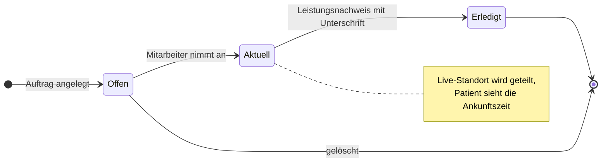
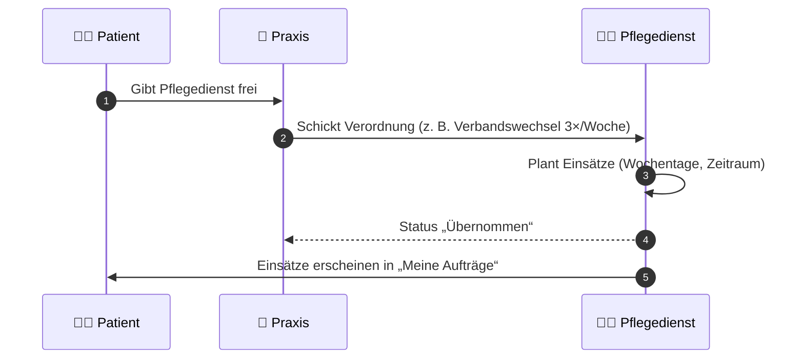
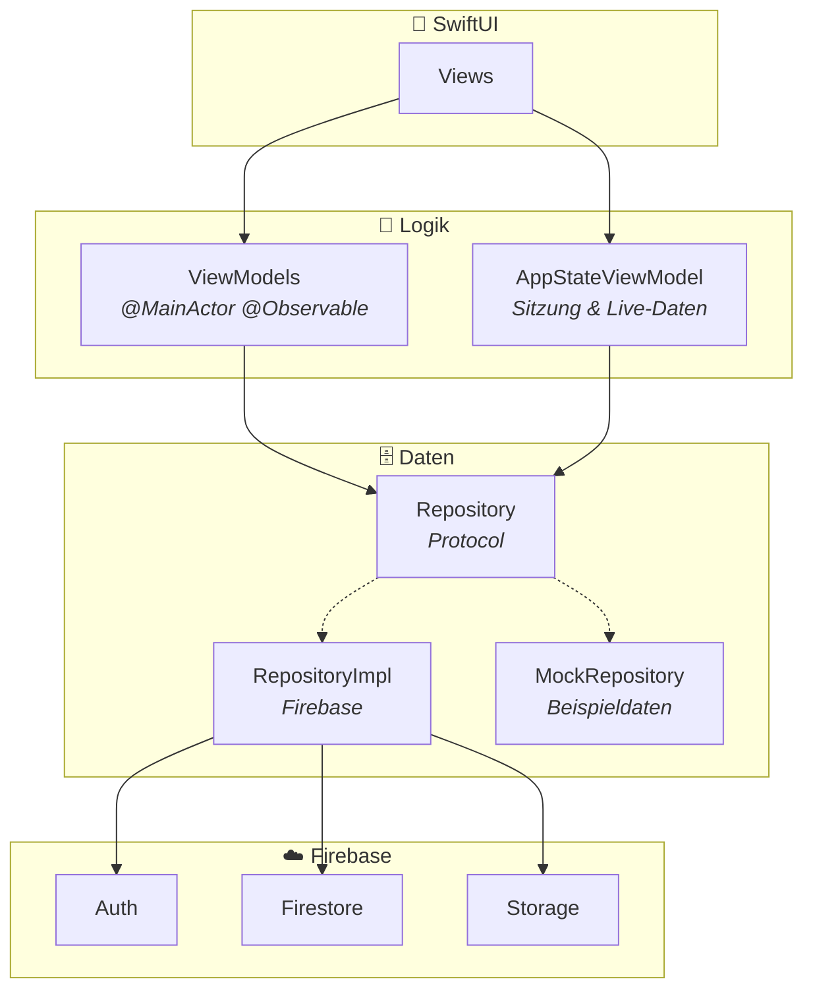
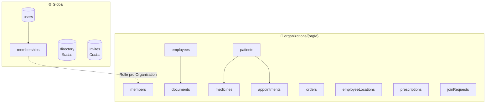

<div align="center">



# CareConnect

**Die Pflege-App, die Pflegedienst, Praxis und Patient in Echtzeit verbindet.**

Aufträge planen, Einsätze live verfolgen, Leistungen digital unterschreiben lassen.<br/>
Alles in einer nativen iOS-App mit SwiftUI und Firebase.

<br/>


<br/>

[Überblick](#-überblick) •
[Screenshots](#-screenshots) •
[Funktionen](#-funktionen) •
[Architektur](#-architektur) •
[Datenmodell](#-datenmodell) •
[Installation](#-installation) •
[Roadmap](#-roadmap)

</div>

---

## 📌 Überblick

In der ambulanten Pflege laufen viele Absprachen noch über Telefon, Zettel und Messenger. Patienten wissen nicht, wann die Pflegekraft kommt, Praxen faxen Verordnungen, und der Leistungsnachweis landet auf Papier.

**CareConnect bringt alle Beteiligten in eine App:**

<table>
<tr>
<td width="33%" valign="top">

### 👩‍⚕️ Pflegekräfte
Sehen ihre Tour für heute, nehmen Aufträge an, navigieren zum Patienten und schließen den Einsatz mit Unterschrift ab.

</td>
<td width="33%" valign="top">

### 🧑‍🦳 Patienten
Sehen live, wo ihre Pflegekraft gerade ist und wann sie ankommt, verwalten Medikamente und Termine und haben den Notruf immer griffbereit.

</td>
<td width="33%" valign="top">

### 🏥 Praxen & Kliniken
Schicken Verordnungen direkt an den Pflegedienst, den der Patient freigegeben hat. Daraus entstehen automatisch die passenden Einsätze.

</td>
</tr>
</table>

> [!NOTE]
> CareConnect gibt es auch als Android-Version (Kotlin Multiplatform). Beide Apps nutzen dasselbe Firebase-Projekt, Daten sind also plattformübergreifend in Echtzeit synchron.

---

## 📸 Screenshots

### Mitarbeiter-App

<table>
<tr>
<td align="center" width="25%"><br/><sub><b>Home</b><br/>Status, Statistik & Team</sub></td>
<td align="center" width="25%"><br/><sub><b>Aufträge</b><br/>Offen, aktuell, erledigt</sub></td>
<td align="center" width="25%"><br/><sub><b>Auftragsdetails</b><br/>Live-Karte & Aktionen</sub></td>
<td align="center" width="25%"><br/><sub><b>Patienten</b><br/>Alle Patienten mit Suche</sub></td>
</tr>
<tr>
<td align="center"><br/><sub><b>Patientenprofil</b><br/>Kontakt, Medizinisches, Karte</sub></td>
<td align="center"><br/><sub><b>Einstellungen</b><br/>Profil & Darstellung</sub></td>
<td></td>
<td></td>
</tr>
</table>

### Patienten-App

<table>
<tr>
<td align="center" width="25%"><br/><sub><b>Home</b><br/>Notruf mit einem Tipp</sub></td>
<td align="center" width="25%"><br/><sub><b>Meine Aufträge</b><br/>Aktiver Einsatz, offen, erledigt</sub></td>
<td align="center" width="25%"><br/><sub><b>Medikamente</b><br/>Morgens, mittags, abends</sub></td>
<td align="center" width="25%"><br/><sub><b>Termine</b><br/>Mit Adresse & Mitbringliste</sub></td>
</tr>
<tr>
<td align="center"><br/><sub><b>Einstellungen</b><br/>Profil & Darstellung</sub></td>
<td></td>
<td></td>
<td></td>
</tr>
</table>

---

## ✨ Funktionen

### Highlights

| | Funktion | Beschreibung |
|:-:|---|---|
| 📍 | **Live-Tracking mit Ankunftszeit** | Der Patient sieht die Pflegekraft auf der Karte, inklusive Route, Entfernung und voraussichtlicher Ankunft. Geteilt wird nur, solange ein Auftrag läuft. |
| ✍️ | **Digitaler Leistungsnachweis** | Beim Abschließen wird dokumentiert, was gemacht wurde, und der Patient unterschreibt direkt auf dem iPhone. |
| 📋 | **Verordnungen von Praxis an Pflegedienst** | Praxen und Kliniken schicken Verordnungen an den freigegebenen Pflegedienst. Aus einer Verordnung entstehen auf Wunsch wiederkehrende Einsätze, z. B. 3× pro Woche für 4 Wochen. |
| 🚨 | **Notruf** | 112 anrufen, Notfallkontakt anrufen oder einen dringenden Auftrag an den Pflegedienst schicken, jeweils mit einem Tipp. |
| 🏢 | **Mehrere Organisationen** | Ein Konto kann zu mehreren Pflegediensten, Praxen oder Kliniken gehören und jederzeit wechseln. |
| 🌍 | **5 Sprachen inkl. Arabisch** | Deutsch, Englisch, Türkisch, Spanisch und Arabisch mit Darstellung von rechts nach links, direkt in der App umschaltbar. |

<details>
<summary><b>👩‍⚕️ Alle Funktionen der Mitarbeiter-App</b></summary>

<br/>

**Home**
- Eigener Status (Verfügbar, Beschäftigt, Pause, Frei, Urlaub)
- Statistik zu offenen, aktuellen und erledigten Aufträgen
- Tour für heute in zeitlicher Reihenfolge, als Route in Google Maps öffnen
- Team-Übersicht mit Status aller Kollegen
- Globale Suche über Mitarbeiter, Patienten und Aufträge

**Aufträge**
- Aufträge anlegen, bearbeiten, annehmen und abschließen
- Annehmen in einer Firestore-Transaktion, damit nie zwei Personen denselben Auftrag bekommen
- Live-Karte mit Route und Ankunftszeit
- Abschluss mit Leistungsnachweis und Unterschrift

**Verordnungen**
- Eingang und Ausgang getrennt
- Übernehmen als einzelner oder wiederkehrender Einsatz
- Ablehnen, als erledigt markieren oder zurückziehen

**Patienten & Team**
- Patientenprofil mit Kontakt, Medikamenten, Terminen, Allergien und Karte
- Notfallkontakt anzeigen und bearbeiten
- Mitarbeiterprofil mit Arbeitszeiten und PDF-Dokumenten

**Organisation (Leitung)**
- Einladungscodes für Mitarbeiter und Patienten
- Beitrittsanfragen annehmen oder ablehnen
- Rollen vergeben, Mitglieder entfernen
- Organisation in der Suche sichtbar machen

</details>

<details>
<summary><b>🧑‍🦳 Alle Funktionen der Patienten-App</b></summary>

<br/>

- Notruf: 112, Notfallkontakt oder dringender Auftrag
- Eigene Aufträge mit Status-Verlauf (Erstellt → Angenommen → Erledigt)
- Live-Standort der Pflegekraft mit Ankunftszeit (nur mit Zustimmung)
- Leistungsnachweis mit Unterschrift einsehen
- Medikamente nach Tageszeit verwalten
- Termine mit Adresse, Mitbringliste und Notizen
- Freigaben: festlegen, welche Praxis Verordnungen an welchen Pflegedienst schicken darf
- Profil, Profilbild und Passwort ändern

</details>

<details>
<summary><b>⚙️ Für alle Nutzer</b></summary>

<br/>

- Registrierung mit Profilbild und Adressvorschlägen
- Organisation per Code beitreten, suchen und anfragen oder selbst gründen
- Push-Benachrichtigungen bei neuen oder geänderten Aufträgen
- Dark Mode
- Sprache in der App wechseln

</details>

---

## 🔄 So funktioniert's

### Vom Login zur passenden App



### Lebenszyklus eines Auftrags



### Verordnung: von der Praxis zum Einsatz



---

## 🏗 Architektur

CareConnect folgt **MVVM** mit **Repository Pattern** und **Dependency Injection**. Views zeigen nur an, ViewModels enthalten die Logik, und Repositories sind die einzige Stelle, die mit Firebase spricht.



| Baustein | Aufgabe |
|---|---|
| **Views** | Reine Darstellung, ViewModel per `@State`, geteilte Daten per `@Environment` |
| **ViewModels** | `@MainActor @Observable`, bereiten Daten auf und reagieren auf Eingaben |
| **AppStateViewModel** | Hält Sitzung, aktuelle Organisation, Einstellungen und alle Live-Daten an einer Stelle |
| **Repository (Protocol)** | Einheitliche Schnittstelle für einen Datenbereich, z. B. `OrderRepository` |
| **RepositoryImpl** | Umsetzung mit Firebase über `FirebaseManager.shared` |
| **MockRepository** | Beispieldaten ohne Firebase, laufen automatisch in den Xcode-Previews |
| **AppContainer** | Stellt die Repositories bereit, in der App Firebase, in der Preview die Mocks |

### Technische Highlights

- **Echtzeit überall:** Firestore-Snapshot-Listener für Aufträge, Patienten, Mitarbeiter, Verordnungen und Standorte
- **Transaktionen:** Ein Auftrag kann nur einmal angenommen werden, auch wenn zwei Personen gleichzeitig tippen
- **Batch-Writes:** Wiederkehrende Einsätze werden in einem Rutsch angelegt
- **Datensparsamer Standort:** Upload nur alle paar Sekunden und erst nach Bewegung, automatisches Löschen nach dem Einsatz
- **Routen mit MapKit:** Fahrzeit und Strecke über Apple, ohne API-Schlüssel
- **Unterschrift als Text:** Striche werden kompakt gespeichert, im gleichen Format wie in der Android-App
- **Moderne Concurrency:** async/await und `@MainActor` als Standard-Isolation, vorbereitet auf Swift 6

---

## 🗂 Datenmodell



Jede Organisation hat ihre eigenen Daten. Ein Konto kann über `memberships` zu mehreren Organisationen gehören. Die Rolle (Leitung, Mitarbeiter, Patient) wird pro Organisation vergeben und über Firestore-Regeln geschützt.

---

## 🛠 Tech-Stack

| Bereich | Technologie |
|---|---|
| Sprache | Swift 5 mit strikter Concurrency |
| UI | SwiftUI, Observation (`@Observable`) |
| Architektur | MVVM, Repository Pattern, Dependency Injection |
| Backend | Firebase Auth, Cloud Firestore, Storage, Cloud Messaging, Crashlytics |
| Karten & Standort | MapKit, CoreLocation |
| Weitere Frameworks | PhotosUI, UserNotifications, UniformTypeIdentifiers |
| Code-Qualität | SwiftLint |
| Mindestversion | iOS 26 |
| IDE | Xcode 26 |

---

## 📁 Projektstruktur

```
CareConnect/
├── App/                      # Einstieg, AppDelegate, AppContainer, RootView
├── Core/
│   ├── Design/               # Farben, Abstände, Kartenstil
│   ├── Extensions/           # Hilfen für Text, Datum, Links
│   ├── Firebase/             # FirebaseManager, Collection-Namen, Listener
│   ├── Localization/         # Sprachauswahl und Übersetzungen
│   ├── Models/               # Datenmodelle (Codable)
│   │   └── Enums/            # Status, Rollen, Organisationstypen
│   ├── Repositories/         # Pro Bereich: Repository, RepositoryImpl, MockRepository
│   ├── Services/             # Standort, Benachrichtigungen, Karten
│   └── ViewModels/           # AppStateViewModel
├── Features/
│   ├── Auth/                 # Login & Registrierung
│   ├── Organization/         # Beitreten, gründen, verwalten
│   ├── Employees/            # Mitarbeiter-App
│   ├── Patients/             # Patienten-App
│   ├── Settings/             # Gemeinsame Einstellungs-Bereiche
│   └── Components/           # Wiederverwendbare UI-Bausteine
└── Resources/                # Assets, App-Icon, Farben
```

---

## 🚀 Installation

### Voraussetzungen

- macOS mit **Xcode 26** oder neuer
- Ein eigenes **Firebase-Projekt** mit Auth (E-Mail/Passwort), Firestore und Storage

### Schritte

```bash
# 1. Repository klonen
git clone https://github.com/Ali-C313/CareConnect-IOS.git
cd CareConnect-IOS

# 2. Projekt öffnen
open CareConnect/CareConnect.xcodeproj
```

3. In der Firebase-Konsole eine iOS-App mit der Bundle-ID des Projekts anlegen
4. Die `GoogleService-Info.plist` herunterladen und nach `CareConnect/CareConnect/Resources/` legen
5. Ein Ziel wählen und mit **⌘ R** starten

> [!IMPORTANT]
> Die `GoogleService-Info.plist` ist absichtlich nicht im Repository enthalten (siehe `.gitignore`). Ohne eigene Datei startet die App nicht.

> [!TIP]
> Für die Xcode-Previews wird kein Firebase gebraucht. Dort laufen automatisch die Mock-Repositories mit Beispieldaten.

---

## 🧭 Roadmap

- [x] Mitarbeiter- und Patienten-App mit Rollen
- [x] Live-Tracking mit Ankunftszeit
- [x] Leistungsnachweis mit Unterschrift
- [x] Verordnungen zwischen Praxis und Pflegedienst
- [x] Push-Benachrichtigungen
- [x] 5 Sprachen inkl. Arabisch
- [ ] Leistungsnachweise als PDF exportieren
- [ ] Kalender mit Erinnerungen für Termine und Medikamente
- [ ] Chat zwischen Pflegekraft und Patient
- [ ] Unit-Tests für die ViewModels mit den Mock-Repositories

---

## 👤 Kontakt

<div align="center">

**Ali Chehab**<br/>
iOS & Android Developer

[](https://www.linkedin.com/in/ali-chehab-32a7a7364)
[](https://github.com/Ali-C313)

<br/>

<sub>CareConnect. Ihre Gesundheit in besten Händen.</sub>

</div>
